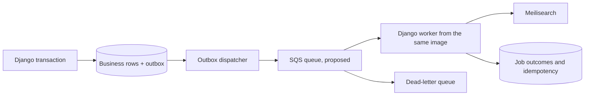

# Background processing proposal

Status: proposal only, November 2, 2026. This branch does not add a broker,
worker process, queue, scheduled job, IAM policy, or production deployment.

## Smallest reliable path

Keep job handlers in the Django modular monolith. Start with a transactional
PostgreSQL outbox and a bounded Django management-command worker for search
synchronization. This uses the existing database and can be tested without an
AWS account. It is a proposed next implementation phase, not an existing feature.

For an AWS deployment, graduate dispatch to an SQS standard queue and DLQ when
independent workers, buffering, or throughput justify it. Use the existing boto3
dependency. A small explicit handler registry is sufficient initially; do not
introduce Celery plus Redis solely to run one retryable search job. Reconsider a
task framework if actual workflows need its orchestration features.

The initial database worker consumes outbox rows directly. SQS is an optional
transport added after that lifecycle is proven; two independent transports are
not required for the first release.

## Execution choices

| Work | Execution | Periodic work |
| --- | --- | --- |
| Search synchronization | Persist an outbox entry in the same transaction as each supported content write; index committed current state | Reconcile missed/admin/bulk changes and index drift |
| Media processing | Submit external processing after verified upload; handle callbacks asynchronously | Reconcile stuck submissions; never transcode inside an HTTP request |
| Playback and advertising events | Validate and durably accept event IDs, then aggregate in batches | Aggregate windows, enforce retention, reconcile late events |
| Ranking | Compute from durable aggregates | Refresh ranking windows using a unique scope/window/version key |
| Maintenance | Bounded, restartable management jobs | Outbox retention, orphan-upload review, dependency checks |
| Time-based public eligibility | Compare database timestamps against current time in public queries | No scheduler needed merely to make a start/end time effective; caches need expiry/invalidation |
| Temporary PINs and reset codes | Existing request-time expiration and attempt checks | Optional cleanup of expired records; no scheduler required for security expiry |

No homepage scheduling, campaign serving, event ingestion, ranking, or transcoding
is implemented by this branch.

## Delivery, retry and idempotency contract

Outbox creation must share the business transaction, not rely on an in-memory
post-commit callback. Record job ID, kind, schema version, aggregate ID, created
time, available-after time, attempts, lease expiry, state and sanitized error code.
Payloads contain identifiers, not credentials, raw tokens, media bytes or arbitrary
serialized Python functions. Claim short batches with row locks/skip-locked,
release transactions before network calls, and recover expired leases.

For SQS, duplicate delivery is expected. Visibility timeout reduces concurrent
processing but does not guarantee one execution. Extend visibility for long jobs,
acknowledge only after durable completion, and use a DLQ for exhausted attempts.
See [AWS visibility-timeout guidance](https://docs.aws.amazon.com/AWSSimpleQueueService/latest/SQSDeveloperGuide/sqs-visibility-timeout.html).

Use a durable unique idempotency key for each effect. Search jobs reload current
approved/unapproved/deleted state and serialize work per content ID so an older
job cannot restore an obsolete document after a newer edit. Event IDs deduplicate
events; aggregate scope/window/version keys prevent double counting. Remote media
submission needs a persisted external operation ID and provider idempotency where
supported. Do not mark a remotely submitted job successful merely because a
request timed out. Exactly-once remote effects cannot be promised.

Retry transient timeouts, rate limits and service failures with bounded
exponential backoff and jitter. Treat invalid payloads/unsupported versions as
terminal. Persist sanitized failures and attempts; alert on oldest pending age,
expired leases and terminal failures. An operator replays selected jobs using
their original identity after fixing the cause; replays must not bypass the
idempotency record.

## Outages and deployment

If SQS is unavailable, committed outbox entries remain pending and the API can
complete its database transaction. If the database cannot persist an event/job,
do not claim durable acceptance. If workers stop, work waits until leases expire
or queue visibility returns. Maintain retention/backup limits for pending work.
Do not perform an unbounded synchronous drain during recovery.

Existing behavior is weaker: search callbacks run synchronously after commit,
log failures, and have no durable retry. Database-backed public search and its
approval filter remain available. This branch preserves that behavior and
documents the outbox as the next independently reviewable reliability slice.

Run workers from the same immutable application image using a separate command,
with migrations disabled in workers. On a confirmed EC2 deployment, a supervised
container with explicit CPU/memory limits is the smallest option if measured
headroom exists. Use a separate ECS/Fargate service only after a platform decision.
Roll out additive schema first, then compatible consumers, then producers. Support
old payload versions during rollout. Roll back producers without dropping pending
outbox data; drain or explicitly migrate queued versions before retiring handlers.

## Scheduling and AWS approval boundary

Periodic jobs need one operational owner: initially an approved host timer, or
EventBridge Scheduler targeting SQS after queue approval. The handler's unique
time-window key makes duplicate schedule invocations harmless. Scheduler retries
and delivery failures need their own DLQ policy; these differ from processing
failures after a worker receives a message.
[AWS Scheduler DLQ guidance](https://docs.aws.amazon.com/scheduler/latest/UserGuide/configuring-schedule-dlq.html).

DevOps approval is required for any proposed SQS queue/DLQ, scheduler and execution
role, worker compute allocation, IAM instance/task role, CloudWatch log group and
alarms, secret-store access, encryption-key policy, VPC endpoint/NAT choice, or
production shared throttle cache. Existing AWS resources and available capacity
have not been verified. No AWS resource is created by this branch.

Cost estimates need region, traffic, worker utilization, retention and processing
volume. SQS costs depend on API requests and payload chunks; retries, polling and
KMS usage affect the bill. Keep media in S3 and queue only references.
[AWS SQS pricing](https://aws.amazon.com/sqs/pricing/).
Compute runtime, log ingestion/retention, scheduler invocation volume and network
egress/translation are additional drivers. Media transcoding is a separate cost
decision in a later workstream. This proposal contains no price quote or spending
authorization.

## Reviewable next steps

1. Outbox schema and atomic search-write capture, with rollback and admin/bulk-path coverage.
2. Bounded database worker with leases, retries, failure records and recovery tests.
3. Staging-only worker operation and reconciliation proof.
4. Optional SQS transport and approved deployment, after duplicate/outage tests.
5. Periodic maintenance, then additional job types as their product branches land.
