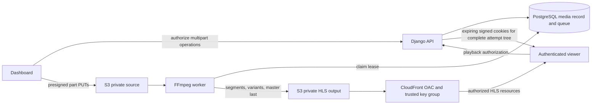

# Branch 4 playback and media operations

This branch implements protected playback and an asynchronous media path. It
does not provision AWS resources, start a production worker, commit, push, merge,
or deploy. Infrastructure changes and the client rollout need review before use.

## Repository and release dependencies

Backend `feat/playback-media` starts at `origin/master` `66c8f14`, the merged
Branch 3 backend. Dashboard starts at its merged `origin/main` `4961486`.
Website starts at `origin/feat/homepage-management` `f81448e`, explicitly depending
on the still-open website Branch 3 PR #29. Keep that dependency separate during
review. Existing backend/dashboard deployment reports are historical evidence;
this branch did not verify or alter the current production runtime.

## Architecture and invariants



Video bytes are uploaded directly from browser to S3. Django authorizes staff,
binds sessions to the uploader, checks completed S3 parts/object metadata, and
stores a media record. It does not proxy large uploads or viewer segments.

Protected upload sources use `cbmvideo/private/<unique-name>`. Public trailer and
advert uploads retain `cbmvideo/<unique-name>`. The returned `delivery_url` is
also the reference used by existing content Save fields; a protected source
reference is **not a playback grant**. Existing full-URL database fields remain.

`MediaAsset.state` follows `uploading -> uploaded -> queued -> processing -> ready`.
Saving the completed protected source onto content/episode/part queues it in the
same transaction. Unattached sources remain uploaded and do not incur automatic
transcoding. Public uploads remain uploaded and can serve as completed public
trailers/adverts. Failed attempts retry with delay, then become failed; explicit
cancel changes an unfinished multipart upload to canceled. An uploaded source
and a ready HLS output are distinct states.

The database queue runs outside HTTP requests. PostgreSQL row locks and
`skip_locked` provide job claims. A UUID lease fences completion, and every
attempt writes a unique `protected/hls/<media-id>/<lease-id>/` tree. A stale or
expired worker cannot mark its output ready. Default maximum attempts is three;
automatic retry delays start at 60 seconds and increase. The lease is the
processing timeout plus 600 seconds; default processing timeout is four hours.
An expired final attempt becomes failed. No Celery, SQS, EventBridge or
MediaConvert deployment is assumed.

## Models, migrations and compatibility

| Migration | Additive change | Existing records |
| --- | --- | --- |
| `content/0019_mediaasset` | Owner-bound source identity, upload ID/size/type/purpose, state, output metadata, failure and lease/retry fields | Existing content URLs are not rewritten or automatically classified as ready HLS |
| `library/0002_partprogress` | Per-account episode/part history, exactly-one-selector check, unique viewer/episode or viewer/part | Existing Branch 3 `WatchProgress` rows and `(user, content)` key remain unchanged |

Progress writes keep the compatible last-viewed `WatchProgress` snapshot and
upsert the selected `PartProgress` in one transaction. Completing an episode
records that episode's completion; it does not create a series-completion record.
Selector reads use new history first and fall back to an existing snapshot only
when its viewer/title/episode or part matches. No historical positions, timestamps
or unseen episode history are fabricated. Existing Branch 3 homepage projection
can advance a completed snapshot to the next available episode without rewriting
the stored snapshot. Deleting a viewer's title progress clears their snapshot
and per-part history, leaving other accounts untouched.

**Client compatibility gate:** public content/episode/part serializers now return
`streaming_link: null` and `playback_available: boolean`. Trailers remain public
where eligible. This is a deliberate breaking change for clients that play raw
catalogue URLs, including old mobile builds. Verify every supported viewer and
dashboard client against the new authorization contract before rolling out the
backend redaction. The mobile repository was not changed in this branch. Do not
deploy the backend independently and assume older clients will keep playing.

Search documents contain discovery metadata, not protected sources. Catalogue,
homepage and nested library representations use the same redaction boundary.
Authorized Content editors retain source references in explicit dashboard scope
(`?scope=dashboard`) and management writes. Known protected references are
rejected in public trailer/season-trailer/advert fields and redacted from legacy
records containing them.

## API contracts

All paths below are relative to the backend origin. Authentication is the existing
JWT infrastructure. Staff media operations retain existing dashboard permissions.
Personalized playback/status/preview/progress responses are private/no-store.

| Method and path | Request | Response and constraints |
| --- | --- | --- |
| `POST /api/content/media/multipart/start/` | `{filename, content_type, size_bytes, purpose?: "protected" or "public"}` | `{token, part_size, part_count, parallelism, delivery_url, media_id}`; server selects unique key and owner; validates video extension/MIME/size |
| `POST /api/content/media/multipart/part/` | `{token, part_number}` | `{upload_url}`; PUT operation valid for 900 seconds, no AWS credentials |
| `POST /api/content/media/multipart/status/` | `{token}` | `{parts:[{PartNumber,ETag,Size}],part_size,part_count}` or `{completed:true,delivery_url,parts:[]}`; owner-bound S3 list, paginated internally |
| `POST /api/content/media/multipart/complete/` | `{token}` | `{delivery_url}`; checks exact part numbers/sizes and HEAD size/MIME; repeat completion returns the same reference |
| `POST /api/content/media/multipart/abort/` | `{token}` | `{canceled:true}`; aborts unfinished multipart upload; a late cancel never deletes completed media |
| `GET /api/content/media/status/?reference_url=...` | Staff identity | `{media_id,state,source_uploaded,ready,renditions,error}`; owner or authorized editor of attached content; unknown/unavailable reference reports legacy |
| `POST /api/content/media/<media-id>/retry/` | Owner staff identity | `202 {queued:true}` for failed protected asset; otherwise 409; resets retry count and queues |
| `POST /api/content/media/preview/` | `{reference_url}`; Content editor | `{url,type:"source",expires_in:300,state}`; completed source only; object-specific S3 GET grant; owner or source already attached to content/episode/part |
| `POST /api/content/<content-id>/playback/` | Authenticated viewer; `{}` for standalone, `{episode:id}` or `{miniseries:id}` | `{state:"ready",type:"hls" or "progressive",url,expires_at,content,episode?,miniseries?,with_credentials}`; selected item must belong to approved content on an active channel |
| `GET /api/library/progress/<content-id>/` | Viewer; optional exactly one `episode` or `miniseries` query selector | Compatible snapshot shape; selector reads exact per-part history or matching legacy snapshot |
| `POST /api/library/progress/` | Existing `{content,position_seconds,duration_seconds,episode?,miniseries?}` | Compatible snapshot response; episodic writes require the correct single selector |

Anonymous playback is 401, unpublished/inactive or wrong-parent media is 404,
invalid selectors are 400. An unready or unmigrated source is 409 with state and
useful detail; unavailable delivery configuration is 503. No unready tracked asset
falls through to progressive playback. Authorization expiry defaults to 900
seconds and is bounded to 60–3600 seconds. Viewers renew before expiry.

Transient S3 status/completion failures return 503, preserving resumable sessions.
If S3 already accepted completion but its response was lost, `NoSuchUpload` can
recover through exact HEAD verification. Invalid/expired sessions or a missing
completed object require a new upload. Signed upload sessions expire after 24
hours. Server-issued part size defaults to 8 MiB, is bounded by S3 limits, and
increases as needed to stay at or below 10,000 parts. Server parallelism is bounded
to 1–8, default four; maximum multipart video size defaults to 100 GiB.

Dashboard retry/reselection resumes server-confirmed parts. Browser persistence
is account-scoped and compares name, size, modification time and SHA-256 samples
of the first/last MiB. This sampled identity does not prove unchanged middle bytes;
resume only by reselecting the original file. Completion validates structure and
size, not a full-file checksum. A future checksum extension must remain compatible.
An abort removes unfinished parts. S3 lifecycle expiry remains necessary for
closed browsers, expired sessions and failed cleanup requests.

## Transcoding provider and output

`MEDIA_TRANSCODING_PROVIDER` is a Django import string, default
`common.transcoding.FFmpegProvider`. The provider is instantiated in the worker:

```python
master_key, renditions = provider.transcode(asset, output_prefix)
```

The supplied output prefix is unique to the leased attempt. A provider must upload
all children and the master before returning, keep every resource under that
prefix, return `<prefix>master.m3u8` and a nonempty rendition list, and raise on
failure. The worker owns state/retry/lease transitions. A future asynchronous
MediaConvert implementation needs a worker-compatible completion/polling adapter;
simply submitting an external job and returning would violate this contract.

FFmpeg uses private S3 downloads into temporary disk, restricted file/pipe/crypto
protocols and MOV/Matroska/WebM demuxers, H.264 Main/yuv420p, up to 30 fps, and AAC
stereo 128 kb/s when audio exists. Silent sources remain without audio. The ladder
uses supported 360/480/720/1080 heights, target video rates 0.8/1.4/2.8/5 Mb/s,
and fits square-pixel display dimensions inside source pixel bounds and 1920×1080.
Sample aspect ratio and quarter-turn rotation are handled without upscaling.
Original source bytes are retained. Validate HDR, multi-audio/subtitles and unusual
container assets separately; they are not additional delivery features here.

VOD playlists use relative paths, six-second MPEG-TS segments, aligned forced
keyframes and independent-segment declarations. Children upload first and master
last. Playlist MIME is `application/vnd.apple.mpegurl`; segments use `video/mp2t`.
Attempt paths are immutable with a one-year cache policy. Failed attempts may
leave unreachable partial output; inventory/delete those after a retention period
without deleting the ready attempt or its source.

## Configuration and delivery prerequisites

| Variable | Meaning |
| --- | --- |
| `AWS_CREDENTIALS_MODE`, `AWS_S3_REGION_NAME`, `AWS_STORAGE_BUCKET_NAME` | Existing backend-only S3 settings; prefer an IAM role/default credential chain where supported |
| `AWS_ACCESS_KEY_ID`, `AWS_SECRET_ACCESS_KEY` | Existing access-key mode only; never frontend variables, images, logs or committed files |
| `CLOUDFRONT_BASE_URL` | HTTPS custom media domain; also determines new reference URLs; existing stored URLs do not change automatically |
| `MEDIA_MULTIPART_PART_SIZE`, `MEDIA_MULTIPART_PARALLELISM`, `MEDIA_MAX_MULTIPART_BYTES` | Default 8388608 bytes, 4, 107374182400 bytes; align API and worker capacity |
| `MEDIA_TRANSCODING_PROVIDER`, `MEDIA_PROCESSING_TIMEOUT` | Provider import string and total processing deadline, default 14400 seconds |
| `PLAYBACK_PROTECTED_DELIVERY_ENABLED` | Default false; operations verification gate before issuing grants |
| `CLOUDFRONT_KEY_PAIR_ID`, `CLOUDFRONT_PRIVATE_KEY_FILE` | Trusted CloudFront public-key identifier and backend-readable RSA private key file; mount secret read-only, never include it in the image |
| `PLAYBACK_COOKIE_DOMAIN`, `PLAYBACK_API_ORIGIN` | Shared parent cookie domain and actual HTTPS API origin, e.g. `example.com` and `https://api.example.com` |
| `PLAYBACK_AUTH_TTL` | Default 900 seconds; server bounds 60–3600 |
| `PLAYBACK_PROTECTED_LEGACY_PREFIXES` | Empty by default; comma-separated progressive-media path prefixes verified to require CloudFront signatures |

Additional Python settings available to a deployment settings module are
`MEDIA_FFMPEG_THREADS` (default two, bounded to 1–8), `MEDIA_FFMPEG_BIN`,
`MEDIA_FFPROBE_BIN`, `MEDIA_TEMP_ROOT`, and `MEDIA_TRANSCODING_MAX_ATTEMPTS`
(default three). These are not automatically mapped from same-named environment
variables in the stock settings module.

HLS uses a custom-policy signed cookie covering only
`https://media.example.com/protected/hls/<id>/<attempt>/*`. All three cookies have
the corresponding attempt path, Secure, HttpOnly and SameSite=None. A signed
master URL alone does not authorize child playlists/segments. Native and JS HLS
must include credentials on child requests. The API and custom CDN hostname must
share the configured parent domain; a `*.cloudfront.net` hostname cannot share
an API-domain cookie. Configure a custom CloudFront alias/certificate/DNS first;
the code fails closed on incompatible domains or absent signing configuration.
See [CloudFront's HLS cookie guidance](https://docs.aws.amazon.com/AmazonCloudFront/latest/DeveloperGuide/private-content-choosing-signed-urls-cookies.html).

Required AWS verification, before enabling delivery or accepting production media:

1. Keep sources private. A historical public bucket allow on `cbmvideo/*` also
   matches `cbmvideo/private/*`; naming a directory private does not protect it.
   Remove/narrow overlapping public allows or apply correctly scoped access
   denials while retaining authorized worker and object-specific staff preview
   access. Preserve explicitly public trailers/images through separate scoped
   policy. Deny anonymous source GET from both S3 and CloudFront.
2. Keep `protected/hls/*` private at S3. Permit CloudFront's OAC/service principal
   for the exact distribution and output prefix. Direct S3 requests must not
   bypass viewer authorization. Configure a trusted key group on **every** HLS
   resource/cache behavior; verify unsigned master, each variant and segments
   all fail, including previously cached objects.
3. Configure explicit trusted dashboard upload origins in S3 CORS. Allow required
   PUT/GET/HEAD and Content-Type/Range headers; expose useful ETag/range headers.
   Configure CloudFront HLS GET/HEAD/OPTIONS, explicit website origins and
   `Access-Control-Allow-Credentials: true`; wildcard origins are incompatible
   with credentials. Forward/cache Origin appropriately or use a reviewed
   response-header policy. Anonymous preflight must succeed; media reads remain
   restricted. Verify browser behavior, not just curl.
4. Verify correct HLS MIME types and immutable output caching. Keep progressive
   `Accept-Ranges`/206 behavior; test seeking and authorization expiry during a
   subsequent range request. Keep signing credentials and full signed URLs out
   of application/access-log payloads and error telemetry.
5. Add `AbortIncompleteMultipartUpload` lifecycle cleanup, for example after one
   day, and a reviewed retention policy for orphan sources/failed attempt output.
   Database records alone do not clean S3 parts. Do not lifecycle-delete live
   ready attempts or their retained rollback sources.

Legacy fallback accepts only HTTPS progressive extensions on the exact configured
CDN origin, without query/fragment, under an explicitly approved protected prefix.
It rejects legacy HLS because a signed master would not cover descendants. Do
not enable a broad legacy `cbmvideo/` behavior without inventorying public trailers
and restricted films. Migrate mixed legacy paths deliberately and revoke old
public originals; changing a database link does not revoke a retained public URL.

## AWS permissions and costs

Upload issuer: scoped `s3:PutObject`, `s3:ListMultipartUploadParts` and
`s3:AbortMultipartUpload` on the permitted source/public prefixes; completion
verification also needs `s3:GetObject` for HEAD. Worker: `s3:GetObject` on sources,
`s3:PutObject` on protected output. Staff preview signing requires permitted
object GET. Cleanup additionally needs scoped listing/deletion only if enabled.
Use conditional `kms:Decrypt`/`kms:GenerateDataKey` only if the chosen bucket
encryption requires them. CloudFront key/group/distribution/OAC management belongs
to an operations principal, not routine upload/viewer requests. Runtime signing
does not require handing AWS credentials to clients.

FFmpeg was selected because the repository contains no deployed transcoding
provider, managed-job callback, queue integration or worker. A PostgreSQL-backed
worker reuses existing infrastructure and isolates CPU work from HTTP. An
existing host still needs measured CPU/memory/disk headroom; shared-host execution
can harm the API. MediaConvert is operationally useful for managed scaling, but
requires supported region/job settings, an S3 service role and `iam:PassRole`,
job submission/read or completion integration, and an approved spend model.
Neither provider is assumed to be free.

Recurring drivers are source/rendition GB-months, multipart/segment S3 requests,
worker CPU hours and scratch disk, CloudFront viewer egress/requests, and any
cross-region transfer. A full four-rung ladder plus four AAC tracks targets about
10.512 Mb/s aggregate: roughly 4.41 GiB per source hour before packaging overhead,
in addition to retained source storage. A viewer averaging 3 Mb/s consumes about
1.26 GiB per watched hour. Multiply these quantities by regional rates and actual
retention/viewing hours. MediaConvert charges normalized output minutes varying
by resolution, codec/frame rate and feature tier; each additional output adds
work. No monthly dollar estimate is justified without workload and region.
Use current [S3 pricing](https://aws.amazon.com/s3/pricing/),
[CloudFront pricing](https://aws.amazon.com/cloudfront/pricing/), and
[MediaConvert pricing](https://aws.amazon.com/mediaconvert/pricing/) before approval.

## Optional worker and resource planning

`docker-compose.media.yml` is a local overlay with an explicit `media-worker`
profile. It uses the same built Dockerfile/image and `.env` configuration as the
API, points to local compose PostgreSQL, overrides the web entrypoint, disables
HTTP healthchecks, runs one job per process, and sets two CPUs, 2 GiB RAM and 256
PIDs. It enables init and drops capabilities. The existing production deployment
workflow is unchanged and does not start this service.

After reviewing the resolved target/configuration and applying migrations once:

```sh
docker compose -f docker-compose.yml -f docker-compose.media.yml --profile media-worker config --quiet
docker compose -f docker-compose.yml -f docker-compose.media.yml --profile media-worker up -d --build media-worker
```

These are instructions, not commands executed by this branch. Inspect the actual
database target before use: Django gives `DATABASE_URL` precedence over `DB_*`.
Never point this local recipe at production accidentally. Production needs a
separately reviewed service definition with the same database/S3/provider settings
and secret mounts, worker monitoring and disk allocation.

Scratch uses a disk-backed named volume at `/tmp`; named volumes have no size
quota. Size a dedicated backing disk for the largest permitted source **plus**
all concurrent rendition files and at least 20% margin; account for each worker
process and abandoned directories after hard termination. A 100 GiB upload limit
is unsuitable for a small default Docker disk. Lower the API's upload limit or
provision measured scratch capacity before accepting such files. Monitor free
space, queued age, processing leases, failures and attempts; use process/container
liveness and queue health, not an HTTP probe. Remove orphan temporary directories
only after confirming their worker has stopped. CPU/RAM limits do not impose a
disk limit. FFmpeg binaries inside the Linux image must be checked separately
from the local Windows binary used for fixture measurements.

## Verification and remaining staging work

Local task-venv backend checks on 4 November 2026:

- Complete suite: **341 tests, 3 PostgreSQL-only skips**, 29.596 seconds.
- Django system check: passed. Migration consistency: no changes detected.
- Dependency check: no broken requirements.
- AWS integrations are mocked, including multipart completion/status and signed
  delivery policy assertions; a generated RSA key verifies the signing path.
- Tests cover ownership, source/readiness guards, public redaction, exact selectors,
  retries/cancel/lost-completion recovery, cookie path/expiry, and lease fencing.

Measured fixture proof is in workspace artifact
`build-artifacts/branch4-encoding-proof.json`; backend log is
`build-artifacts/branch4-backend-tests.log` (outside this repository). Real FFmpeg
8.1.1 encoded generated fixtures; real ffprobe parsed the HLS streams. S3 was
mocked in memory. Results are local CPU wall times, not upload/startup benchmarks:

| Synthetic fixture | Output dimensions | Encode seconds |
| --- | --- | --- |
| 8 s, 640×480, silent | 480×360 and 640×480; two segments each | 6.115 |
| 8 s, 640×480, AAC audio | 480×360 and 640×480; two segments each | 6.268 |
| 2 s, 720×576, SAR 16:15 | 480×360 and 640×480, square pixels, 4:3 display | 1.972 |
| Same anamorphic source, actual 90° display matrix | 270×360, 360×480, 540×720, square pixels, 3:4 display | 3.719 |

Master-last order, output MIME types, referenced segment existence and VOD
termination were checked. These fixtures do not establish real-device playback,
quality-switch performance, upload throughput, startup latency or rebuffer rate.

Current AWS policy/CORS/OAC/key-group/MediaConvert availability was not verified:
the local credential chain had no credentials. Docker's Linux engine was also
unavailable, so local PostgreSQL concurrency and Docker-image execution were not
run. Run PostgreSQL CI and verify the actual worker image before release.

Staging must exercise large/interrupted uploads, retry/reselect after a browser
restart, cleanup, worker kill/reclaim, failures/retries, no-audio and representative
real media, signed-cookie attachment on native and JS HLS, every unauthorized
playlist/segment path, expiry/renewal, progressive range seeking, Google login,
account switching and expired-session recovery, movie/episode resume, trailer
completion, autoplay rejection, mobile viewports and all supported API clients.
Measure upload bytes/time and retry cost, time to first playing frame, buffering
events/time, quality switches and failures. Preserve existing advert behavior;
any advertising sequencing extension belongs to Branch 6.

Google server ID-token signature/issuer/audience/expiry/email verification,
subject binding, explicit linking proof and administrator restrictions are reused.
Configure backend `GOOGLE_OAUTH_CLIENT_IDS` and website
`NEXT_PUBLIC_GOOGLE_CLIENT_ID` consistently, with exact HTTPS origins (and explicit
localhost scheme/port for development) registered in Google Cloud. Never use a
client-supplied email as proof. Existing JWT refresh/account isolation and safe
movie/episode return destinations must be tested with real allowed Google
accounts in staging; no OAuth secrets are included here.

## Deployment and rollback plan

1. Review the three independent diffs and the website Branch 3 dependency. Verify
   all viewer/dashboard/mobile API consumers, private-delivery policy, approved
   costs, worker disk sizing and signing-secret mounting. Take and restore-test
   a database backup and record existing bucket/distribution policies.
2. Apply additive migrations after the backup. Keep protected delivery disabled
   until the private source/output policy, CloudFront custom domain/key group,
   CORS and both anonymous/signed staging checks pass. Do not expose new source
   prefixes through historical public wildcard policies while waiting.
3. Roll out compatible clients and backend as a coordinated change. Start one
   reviewed worker, submit a representative source, and prove the complete
   uploaded/queued/processing/ready lifecycle before enabling general uploads
   or viewer grants. Legacy fallback prefixes need separate verified protection.
4. Enable grants only after these checks, observe queue age/failures/resources and
   viewer startup/rebuffer/error measurements, then expand traffic deliberately.

Rollback stops workers and new media intake, disables new grants where needed,
and reverts backend and clients together to compatible versions. **Retain the
additive database tables and rows** when reverting code; do not reverse migrations
or drop new progress history as a routine rollback. Retain source/ready outputs
and deployment records. Do not reopen private bucket/CDN paths simply to make an
old client work. Existing grants remain usable until expiry; changed links do not
revoke already issued signed URLs/cookies or public originals. Restore a backup
only for demonstrated data damage, through a separately reviewed recovery plan.
